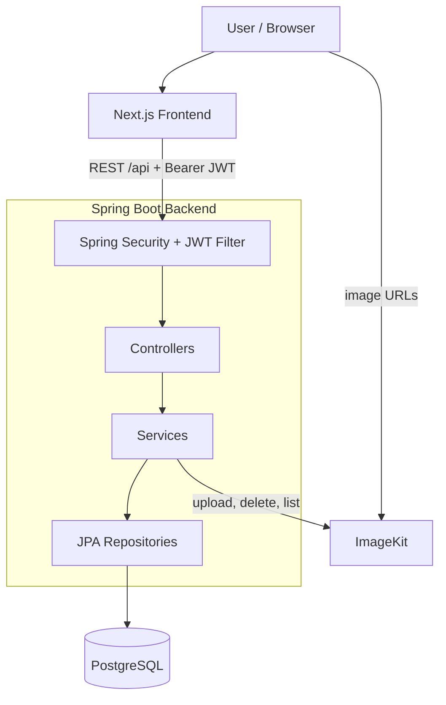
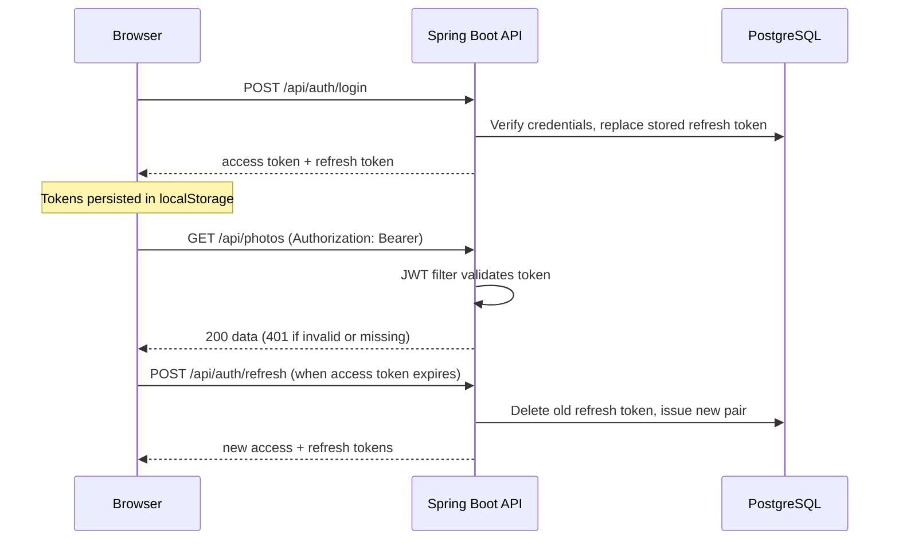
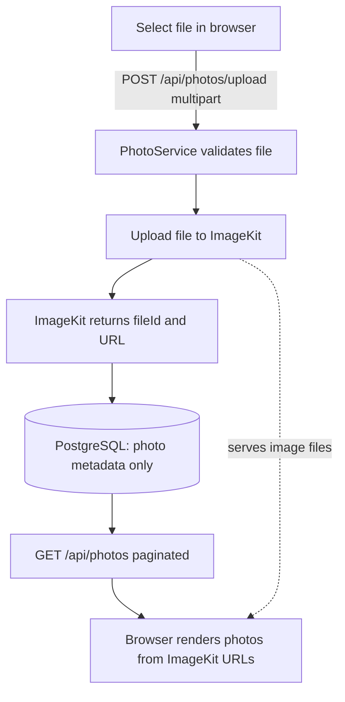

# Pixora

Pixora is a full-stack photo management application inspired by Google Photos. Users can sign up, upload photos, organise them into albums (optionally PIN-protected), archive or trash them, and edit them with non-destructive, ImageKit-powered transformations.

[](https://pixora-six-lake.vercel.app/)


- **Live demo:** https://pixora-six-lake.vercel.app/
- **Repository:** https://github.com/sandipkumarjha/Google-Photos-Springboot

## Features

- **Authentication:** register, login, logout, access/refresh JWT pair with refresh-token rotation, automatic token refresh on the client.
- **Photo library:** multipart upload (up to 20 MB per file), import of existing ImageKit assets, search, sorting (newest, oldest, name, largest), pagination, bulk actions.
- **Lifecycle states:** archive, trash, restore, and permanent delete (trashed photos only; also removes the file from ImageKit).
- **Albums:** create, rename, set cover, add/remove photos, delete.
- **Locked albums:** PIN-protected albums with failed-attempt tracking and a short-lived unlock token sent in the `X-Album-Token` header.
- **Photo editor:** crop, aspect crop, resize, rotate, flip, grayscale, blur, sharpen, contrast, rounding, border, opacity, trim, with live preview and apply-as-new-version.
- **AI edits (via ImageKit):** background removal, background change, generative fill, smart/object crop, retouch, upscale, prompt-based edit.
- **Version lineage:** edited photos keep a link to their parent photo.
- **Storage summary:** library usage and ImageKit usage figures.

## Tech Stack

| Area | Technology | Role |
| --- | --- | --- |
| Frontend | Next.js 16 (App Router), React 19, TypeScript | UI, routing, client-side route guards |
| | Tailwind CSS 4, shadcn/ui, Base UI, lucide-react | Styling and components |
| | TanStack Query, Zustand | Server state; auth, selection, upload and editor state |
| | react-hook-form, zod | Form handling and validation |
| Backend | Spring Boot 4.1, Java 21, Spring Web MVC | REST API |
| Database / ORM | PostgreSQL, Spring Data JPA (Hibernate) | Users, photo metadata, albums, refresh tokens |
| Auth / security | Spring Security, JJWT 0.12, BCrypt (strength 12) | Stateless JWT auth, password hashing, CORS |
| Image storage | ImageKit (`image-kit-java` SDK) | File storage, delivery URLs, URL-based transformations |
| Infrastructure | Docker (backend image), Docker Compose (local PostgreSQL) | Packaging and local database |
| Tooling | Maven (wrapper), pnpm, ESLint, JUnit (Spring Boot test starters) | Build, lint, tests |

## System Architecture



## Application Flows

### Authentication



### Photo Management



Image files live in ImageKit. PostgreSQL stores only metadata (ImageKit file ID, URL, thumbnail URL, name, size, dimensions, status, parent/edit info).

## Project Structure

```
.
├── docker-compose.yml          # Local PostgreSQL 16
├── backend/                    # Spring Boot API (Maven)
│   ├── Dockerfile
│   ├── pom.xml
│   └── src/main/
│       ├── java/project/backend/
│       │   ├── config/         # Security, CORS, JWT, ImageKit configuration
│       │   ├── security/       # JwtAuthenticationFilter
│       │   ├── controllers/    # Auth, Photo, Album, Library, PhotoEdit, PhotoAi
│       │   ├── services/       # Business logic, ImageKit integration
│       │   ├── repository/     # Spring Data JPA repositories
│       │   ├── domain/         # JPA entities and enums
│       │   ├── dto/            # Request/response models
│       │   └── exception/      # Custom exceptions, global handler
│       └── resources/application.properties
└── client/                     # Next.js frontend (pnpm)
    ├── app/                    # Routes: (auth), (app)/photos|albums|archive|trash|dashboard
    ├── components/             # UI by feature (photos, albums, editor, ...)
    ├── hooks/                  # TanStack Query hooks
    ├── stores/                 # Zustand stores
    └── lib/                    # API client, ImageKit helpers, utilities
```

## Getting Started

**Prerequisites:** Java 21, Node.js with pnpm, Docker (for PostgreSQL), and an [ImageKit](https://imagekit.io/) account.

```bash
git clone https://github.com/sandipkumarjha/Google-Photos-Springboot.git
cd Google-Photos-Springboot
```

1. **Database** – start PostgreSQL (maps to port `5424`, database `google_photos`):
   ```bash
   docker compose up -d
   ```
   Tables are created automatically (`spring.jpa.hibernate.ddl-auto=update`).

2. **Backend** – set the variables below, then run on port `8080`:
   ```bash
   cd backend
   export DB_PASSWORD=<must match POSTGRES_PASSWORD in docker-compose.yml>
   export JWT_SECRET=<your-long-random-secret>
   export IMAGEKIT_PUBLIC_KEY=<...> IMAGEKIT_PRIVATE_KEY=<...> IMAGEKIT_URL_ENDPOINT=<...>
   ./mvnw spring-boot:run
   ```

3. **Frontend** – point the client at the local API (it otherwise defaults to the deployed backend), then run on port `3000`:
   ```bash
   cd client
   pnpm install
   NEXT_PUBLIC_API_URL=http://localhost:8080 pnpm dev
   ```

The repository does not include `.env.example` files; variables are read from the environment.

## Environment Variables

| Variable | Purpose | Used in | Required |
| --- | --- | --- | --- |
| `DB_URL` | JDBC URL (default `jdbc:postgresql://localhost:5424/google_photos`) | Backend | No |
| `DB_USERNAME` | Database user (default `postgres`) | Backend | No |
| `DB_PASSWORD` | Database password | Backend | Yes |
| `JWT_SECRET` | Signing secret for JWTs | Backend | Yes |
| `CORS_ALLOWED_ORIGINS` | Comma-separated allowed origins (default `http://localhost:3000`) | Backend | No locally; set when deployed |
| `IMAGEKIT_PUBLIC_KEY` | ImageKit public key | Backend | Yes for uploads |
| `IMAGEKIT_PRIVATE_KEY` | ImageKit private key | Backend | Yes for uploads |
| `IMAGEKIT_URL_ENDPOINT` | ImageKit URL endpoint | Backend | Yes for uploads |
| `PORT` | Server port in the Docker image (default `8080`) | Backend | No |
| `NEXT_PUBLIC_API_URL` | Backend origin, with or without `/api`; inlined at build time | Frontend | No (defaults to deployed backend) |

## API Overview

All routes are prefixed with `/api`. Every route except the four public auth endpoints requires `Authorization: Bearer <access token>`.

| Method | Route | Purpose | Auth |
| --- | --- | --- | --- |
| POST | `/auth/register` | Create account | Public |
| POST | `/auth/login` | Log in, receive tokens | Public |
| POST | `/auth/refresh` | Rotate refresh token | Public |
| POST | `/auth/logout` | Revoke refresh token | Public |
| GET | `/auth/me` | Current user | Required |
| GET | `/photos` | List photos (`status`, `page`, `size`, `q`, `sort`) | Required |
| GET | `/photos/{id}` | Photo details | Required |
| GET | `/photos/{id}/versions` | Parent and derived photos | Required |
| POST | `/photos/upload` | Upload photo (multipart `file`) | Required |
| POST | `/photos` | Register an existing ImageKit file | Required |
| POST | `/photos/archive` | Archive photos | Required |
| POST | `/photos/trash` | Move photos to trash | Required |
| POST | `/photos/restore` | Restore photos | Required |
| POST | `/photos/delete-permanent` | Permanently delete trashed photos | Required |
| DELETE | `/photos/{id}` | Permanently delete a single trashed photo | Required |
| POST | `/photos/{photoId}/edits/preview` | Preview edit steps | Required |
| POST | `/photos/{photoId}/edits/apply` | Apply edit steps as a new photo | Required |
| POST | `/photos/{photoId}/ai/preview` | Preview AI transformation | Required |
| POST | `/photos/{photoId}/ai/apply` | Apply AI transformation | Required |
| GET | `/albums` | List albums | Required |
| POST | `/albums` | Create album | Required |
| GET | `/albums/{id}` | Album details | Required |
| GET | `/albums/{id}/photos` | Album photos (paginated) | Required |
| PATCH | `/albums/{id}` | Update album | Required |
| DELETE | `/albums/{id}` | Delete album | Required |
| POST | `/albums/{id}/lock` | Set PIN lock | Required |
| PATCH | `/albums/{id}/lock` | Change PIN | Required |
| POST | `/albums/{id}/lock/remove` | Remove PIN lock | Required |
| POST | `/albums/{id}/unlock` | Unlock album, receive album token | Required |
| POST | `/albums/{id}/photos` | Add photos to album | Required |
| DELETE | `/albums/{id}/photos/{photoId}` | Remove photo from album | Required |
| GET | `/library/storage` | Storage usage | Required |
| GET | `/library/imagekit-assets` | List importable ImageKit assets | Required |
| POST | `/library/import` | Import ImageKit assets | Required |

## Deployment

- **Frontend:** deployed on Vercel at https://pixora-six-lake.vercel.app/. Set `NEXT_PUBLIC_API_URL` at build time.
- **Backend:** the client's default API URL points to a Render-hosted service (`google-photos-springboot.onrender.com`). `backend/Dockerfile` builds a Java 21 image and honours the `PORT` variable. Configure the backend variables above, and set `CORS_ALLOWED_ORIGINS` to the frontend origin.
- **Image storage:** ImageKit, configured through the `IMAGEKIT_*` variables.
- **Database:** any PostgreSQL instance reachable through `DB_URL`; the repository only configures a local Docker Compose database.

## Future Improvements

Not yet implemented:

- Add an Actuator dependency so the permitted `/actuator/health` path has an endpoint behind it.
- Introduce database migrations (e.g. Flyway) in place of `ddl-auto=update`.
- Expand automated test coverage (currently two service tests plus a context test).
- Add `.env.example` files for the backend and frontend.
